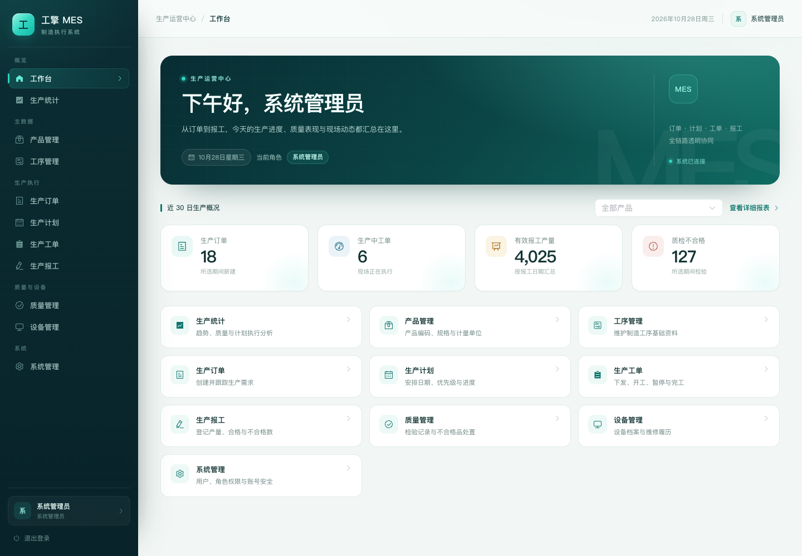
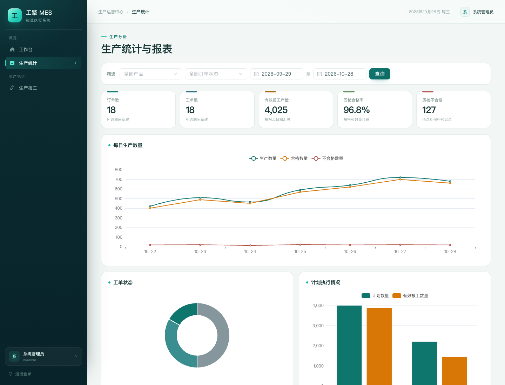
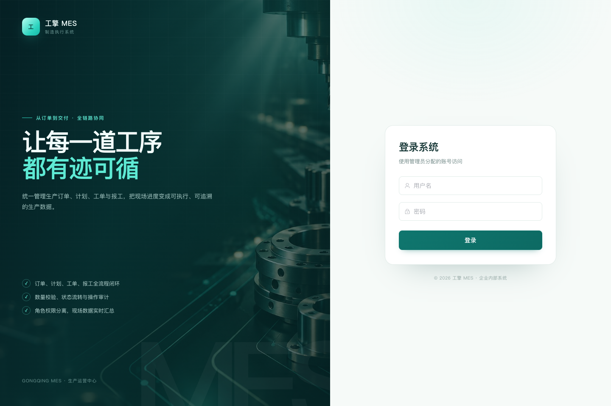
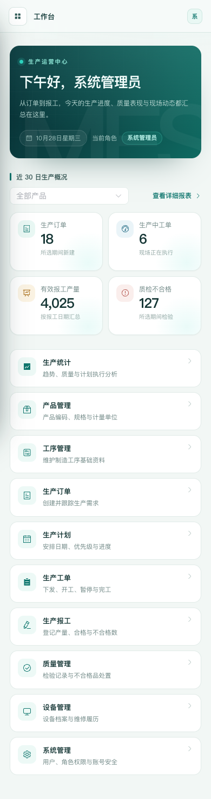

# 工擎 MES

工擎 MES 是面向中小型制造企业的制造执行管理系统。当前已实现用户认证与 RBAC、用户/角色/权限管理、个人资料与密码修改，以及产品、工序、生产订单、生产计划、生产工单、生产报工、质量、设备和生产统计模块，形成从订单到报工、质检、完工的完整业务闭环。

## 项目预览

| 工作台 | 生产统计 |
| --- | --- |
|  |  |

| 登录页 | 移动端 |
| --- | --- |
|  |  |

项目介绍一页纸与 3 分钟演示脚本见 [docs/showcase/](docs/showcase/)。

## 技术栈

- 后端：Java 17、Spring Boot 3.5.x、Maven、MyBatis-Plus、MySQL 8
- 前端：Vue 3、Vite、Element Plus、Axios、Vue Router、Pinia、ECharts

## 界面设计

前端采用深青工业风侧栏、统一设计变量和响应式布局，覆盖登录、工作台、统计、报工及全部业务列表页。设计说明、页面截图和响应式断点见 [docs/frontend-redesign.md](docs/frontend-redesign.md)。本次升级不改变后端接口、权限和业务规则。

## 环境要求

- JDK 17
- Maven 3.9+
- Node.js 22+（本机 Node 26 也可运行）和 npm
- MySQL 8

## 配置

复制根目录 `.env.example` 为 `.env` 或 `frontend/.env.example` 为 `frontend/.env.local`，按本地环境设置变量。Spring Boot 不会自动读取根目录 `.env`；启动后端前请在当前 Shell 导出所需变量（例如 `set -a; source ../.env; set +a`），或由 IDE/Docker Compose 注入。不要提交真实密码、密钥或本地 `.env` 文件。

后端数据库变量：

| 变量 | 默认值/说明 |
| --- | --- |
| `SPRING_PROFILES_ACTIVE` | `dev` |
| `SERVER_PORT` | `8080` |
| `DB_URL` | MySQL JDBC URL，默认本地 `gongqing_mes`、UTC 时区 |
| `DB_USERNAME` | 数据库用户，默认 `root` |
| `DB_PASSWORD` | 数据库密码，默认空；必须由本地环境提供，不提交到仓库 |
| `DB_POOL_MAX_SIZE` | Hikari 最大连接数，dev 默认 10、prod 默认 20 |
| `DB_POOL_MIN_IDLE` | Hikari 最小空闲连接数，dev 默认 2、prod 默认 5 |
| `DB_CONNECTION_TIMEOUT_MS` | 获取连接超时，默认 30000 毫秒 |
| `DB_VALIDATION_TIMEOUT_MS` | 校验连接超时，默认 5000 毫秒 |
| `LOG_PATH` | prod 滚动文件日志目录，默认 `logs` |

前端 `VITE_BACKEND_URL` 默认指向 `http://localhost:8080`。Vite 开发服务器把 `/api` 请求代理到后端。

初始化数据库后，首次启动空库时可以通过环境变量 `BOOTSTRAP_ADMIN_USERNAME` 和 `BOOTSTRAP_ADMIN_PASSWORD` 创建首个管理员。密码至少 12 位，应用只将 BCrypt 哈希写入 `sys_user.password_hash`；发现任何用户记录后 bootstrap 自动跳过。bootstrap 需要先用 `docs/sql/init.sql` 建表并初始化角色/权限。不要在命令行参数、日志或提交文件中放置生产密码。

生产计划发布后，可在“生产工单”页面从已发布计划创建唯一一张等量工单；工单状态操作和报工完成口径见 [docs/production-workorder-design.md](docs/production-workorder-design.md)。已有数据库升级需按顺序应用版本化 SQL，包括 V4 状态约束和 V5 一计划一工单唯一约束；新库直接执行最新 `docs/sql/init.sql`。

### Profile 配置

- `application.yml`：所有环境共用的数据库、Jackson、MyBatis-Plus、服务端口设置。
- `application-dev.yml`：开发日志级别和连接池默认值。
- `application-test.yml`：较小连接池和安静日志级别；测试数据库需单独通过 `DB_URL` 等变量指定。
- `application-prod.yml`：生产连接池默认值和 INFO 日志。生产密码仍必须由部署环境注入。

MyBatis-Plus 启用了 MySQL 分页拦截器并限制单页最多 100 条。公共 `PageQuery` 提供 page/size 与排序参数格式；每个查询还必须对白名单排序字段，不可把请求值直接拼进 SQL。

API 正常和错误响应使用 `{ code, message, data, traceId }`。参数错误返回 HTTP 400；业务冲突返回 HTTP 409；未预期错误返回不含堆栈的 HTTP 500。日志通过 `X-Trace-Id` 关联请求，dev/test 输出控制台，prod 输出控制台和按大小/日期滚动文件。

认证使用 Spring Security Session，浏览器凭据放在 HttpOnly Cookie；CSRF 使用 `XSRF-TOKEN` Cookie 和 `X-XSRF-TOKEN` 请求头。登录失败统一返回 401，不区分用户名、密码或账号状态。所有 `/api/v1/**` 端点除登录和 CSRF 初始化外均需登录；系统管理 API 使用 `@PreAuthorize` 校验数据库当前有效角色关联产生的权限编码。停用用户不能登录；服务端禁止停用最后一名启用状态的管理员，也禁止移除其管理员角色。生产环境需经 HTTPS 部署，设置 `SESSION_COOKIE_SECURE=true`。

认证接口：`GET /api/v1/auth/csrf`、`POST /api/v1/auth/login`、`GET /api/v1/auth/me`、`POST /api/v1/auth/logout`；已登录用户可通过 `PUT /api/v1/auth/profile` 修改显示名称，通过 `POST /api/v1/auth/change-password` 校验当前密码后修改本人密码。用户及角色管理 API 位于 `/api/v1/system`，需要 `system:user:manage`、`system:role:manage` 或 `system:permission:read` 权限。角色/权限关联更新为整体替换语义。前端“系统管理”页面提供用户启停与角色分配、角色权限配置和个人设置。

产品 API 位于 `/api/v1/products`，工序 API 位于 `/api/v1/processes`。两者支持分页（`page`、`size`）、关键字及状态筛选，分别使用 `product:read/manage` 和 `process:read/manage` 权限；不提供物理删除接口，编码由数据库唯一索引兜底。`docs/sql/V2__product_process_permissions.sql` 为已有库补充工序权限的增量脚本，新库可直接使用更新后的 `docs/sql/init.sql`。

生产订单 API 位于 `/api/v1/orders`：列表按订单号、产品、状态及交期范围筛选，支持分页；详情使用 `GET /{id}`，执行汇总使用 `GET /{id}/execution`（关联计划、工单及有效报工数量），新增/编辑使用 POST/PUT。订单管理权限为 `order:read`、`order:manage`、`order:confirm`、`order:cancel`。草稿订单可确认；草稿/已确认订单在无已发布计划和有效报工时可取消，同时将其草稿计划及待开工工单取消。确认与取消使用独立的 `PATCH /{id}/confirm`、`PATCH /{id}/cancel` 权限校验。订单仅保存要求交期；计划开始/结束日期归生产计划模块。编辑请求需携带详情返回的 `expectedUpdatedAt`，服务端以锁和更新时间条件拒绝过期修改。创建、编辑、确认、取消动作与订单写入在同一事务内写入 `sys_operation_log`。订单号唯一由数据库约束保证。

新建生产订单时，订单服务必须自行校验引用产品的 `status='ACTIVE'` 且 `is_deleted=0`；前端产品选择器过滤不能代替此服务端检查。

生产计划 API 位于 `/api/v1/plans`，支持可排产订单查询、计划分页筛选、详情、新增草稿、编辑草稿、发布和取消。一个已确认订单最多一份计划，计划数量必须等于订单数量；日期需落在订单交期内。发布计划只将计划设为已发布；之后由工单模块从计划显式创建一张完整数量的工单。取消时后端检查工单状态和有效报工。计划操作权限为 `plan:read`、`plan:manage`、`plan:publish`、`plan:cancel`。详细规则与请求字段见 `docs/production-plan-design.md`。新环境初始化脚本已经包含计划优先级；已部署旧表需先检查字段后再执行 `docs/sql/V3__production_plan_priority.sql`。

生产工单 API 位于 `/api/v1/work-orders`，支持从已发布计划建单、分页筛选、详情、关联报工查询和下发/开工/暂停/恢复/完成。一个计划仅创建一张工单，数量与计划数量相同。状态变化由服务端校验并写操作日志；完成要求有效报工数量恰好等于计划数量。权限为 `workorder:read`、`workorder:manage`，报工查询也允许 `report:read`。既有数据库需按需执行 `docs/sql/V4__work_order_lifecycle.sql` 扩展状态约束和 `docs/sql/V5__one_work_order_per_plan.sql` 保证计划内唯一；新建数据库使用已包含最新约束的 `docs/sql/init.sql`。详细规则见 `docs/production-workorder-design.md`。

生产报工 API 位于 `/api/v1/reports`。操作员可查看生产中的可报工单、提交数量和查询本人记录；具有 `report:read` 的角色可全局筛选记录，`report:void` 可在工单仍生产中时按原因作废并保留原记录。每次请求用 UUID 请求键防重；服务端在事务中锁定工单行、汇总有效产量并验证不超过计划量后再插入报工。数量明细不可编辑，作废后通过新记录更正。数据库结构沿用 `mes_report`，无需迁移。实现细节见 `docs/production-report-design.md`。

质量管理 API 位于 `/api/v1/quality`，支持质检记录新增、历史分页筛选和不合格品处置。检验必须关联工单，可选关联有效报工；服务端锁定工单并校验累计检验数不超过有效报工合格数。质检记录采用追加写入，处置状态变化写入操作日志。设备管理 API 位于 `/api/v1/equipment`，支持设备档案、状态和维修历史；维修流程与设备状态在同一事务更新，设备编号由数据库唯一约束保证。设备状态为人工维护字段，不代表传感器或 PLC 采集数据。权限码分别为 `quality:read/create/dispose` 和 `equipment:read/manage/maintain`。新数据库执行最新 `docs/sql/init.sql`；已有数据库执行 `docs/sql/V6__quality_and_equipment.sql`。接口及表设计见 `docs/quality-equipment-design.md`。

首页统计和生产报表 API 位于 `/api/v1/statistics`，要求 `statistics:read`。看板和明细支持日期范围、产品及订单状态筛选，指标口径、日期边界、接口参数及已有库索引升级见 `docs/statistics-design.md`；新库执行最新 `docs/sql/init.sql`，已有库按需应用 `docs/sql/V7__statistics_date_indexes.sql`。

后端公共类位于 `com.gongqing.mes.common`：`ApiResponse` 定义响应信封，`GlobalExceptionHandler` 负责参数、业务、数据库和未预期异常映射，`PageQuery`/`PageResult` 约定分页入参和出参。Controller 使用 Jakarta Bean Validation（`@Valid`/`@Validated`）；分页排序列必须由每个业务查询按允许字段白名单映射，不能直接拼接请求字符串。

## 启动后端

```bash
cd backend
mvn spring-boot:run
```

健康检查：

```bash
curl http://localhost:8080/api/health
```

## 启动前端

```bash
cd frontend
npm install
npm run dev
```

打开 <http://localhost:5173> 进入登录页。需要先完成 MySQL schema 初始化并通过环境变量 bootstrap 首位管理员。

## 构建和测试

```bash
(cd backend && mvn test)
(cd frontend && npm run build)
```

后端公共层验证命令：

```bash
cd backend
mvn clean test
mvn package
```

数据库集成测试（需先通过 `DB_URL`、`DB_USERNAME`、`DB_PASSWORD` 配置已执行的测试数据库；测试数据在事务回滚）：

```bash
cd backend
mvn -Dmes.integration=true -Dtest='*DatabaseSmokeTest' test
# 单独运行产品→订单→计划→工单→报工/作废→质检→完工→设备维修全链路：
mvn -Dmes.integration=true -Dtest=MesWorkflowDatabaseSmokeTest test
```

面向业务用户的操作说明见 [docs/user-guide.md](docs/user-guide.md)；本轮验收记录见 [docs/acceptance-test-report.md](docs/acceptance-test-report.md)。

## 目录结构

```text
backend/                  Spring Boot 后端骨架
  src/main/java/...       应用入口、统一响应/异常/分页、健康接口
  src/main/resources/     数据源、MyBatis-Plus、多环境和 Logback 配置
frontend/                 Vue/Vite 前端骨架
  src/api/                Axios 实例、认证、系统管理、产品、工序、订单、计划、工单、报工、质量、设备和统计接口
  src/styles/             全局样式
  src/App.vue             路由出口
  src/router/             登录保护路由
  src/stores/             前端登录状态
  src/components/         共享应用头部与权限导航
  src/views/              登录、工作台、产品、工序、订单、计划、工单、报工、质量、设备、统计和系统管理页面
docs/                     需求、架构、数据库设计及 SQL
```

数据库初始化 SQL 位于 `docs/sql/init.sql`，应用启动不会自动执行 DDL；部署前按环境单独初始化数据库。

## 当前未实现

Flyway 自动迁移和完整生产部署编排将在后续阶段实现。首个管理员通过环境变量 bootstrap，系统不提供硬编码初始密码。用户认证、权限与密码修改说明见 [docs/authentication-design.md](docs/authentication-design.md)。
