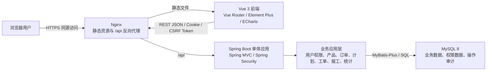
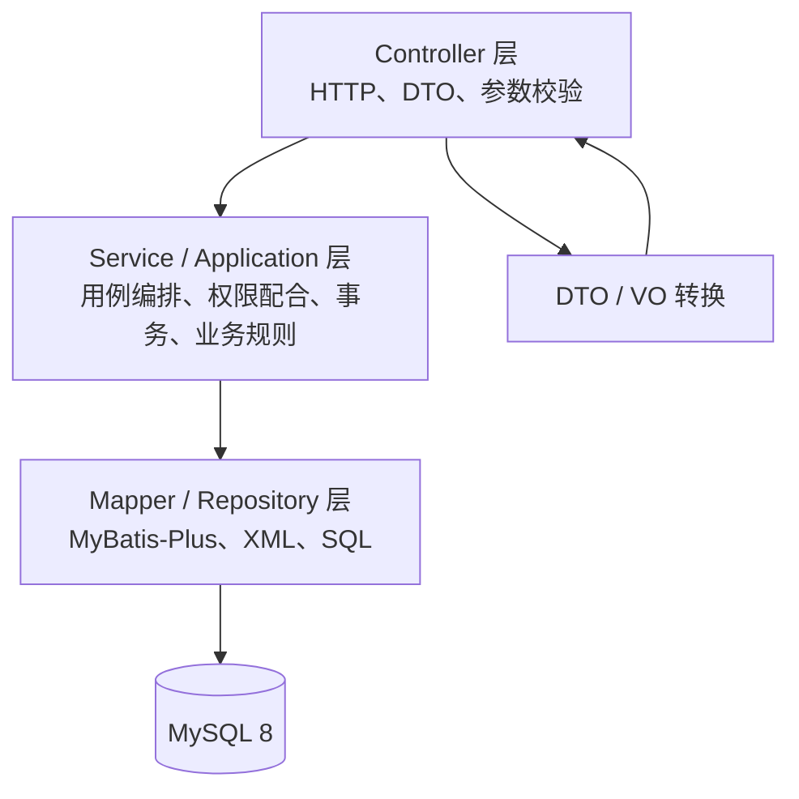

# 工擎 MES 系统架构设计

| 项目 | 内容 |
| --- | --- |
| 项目名称 | 工擎 MES |
| 文档版本 | 1.0 |
| 文档状态 | 架构方案，待评审确认 |
| 编写日期 | 2026-10-19 |
| 依据 | [需求规格说明书](requirements.md) |

## 1. 设计目标与约束

本文基于需求规格说明书，为第一版设计本科生可逐步实现的前后端分离单体架构。架构需要支持产品、生产订单、生产计划、生产工单、报工、进度统计和 RBAC 权限，同时保证报工并发下数量不超计划。

设计约束：

- 后端以一个 Spring Boot 应用部署，前端以一个 Vue 应用构建；不拆微服务。
- 使用 MySQL 8 作为唯一业务数据库；不引入 Redis、消息队列、服务注册、分布式事务或独立搜索服务。
- 按业务模块分包，模块内部遵守清楚的分层；模块间在同一进程内调用服务接口。
- 先采用服务端会话认证和单实例部署，保留将来横向扩展的可能，但不为尚未提出的规模提前增加基础设施。
- 报工明细是产量事实来源；订单、计划、工单的进度在事务中根据有效报工更新或查询汇总。

## 2. 系统总体架构

系统采用浏览器前端、Spring Boot REST API 和 MySQL 的三层部署结构。开发时 Vite 开发服务器将 `/api` 代理到本地后端；生产时 Nginx 提供前端静态资源，并把 `/api` 同源转发给 Spring Boot。浏览器只访问同一站点，不需要在生产环境开放跨域访问。



前端不直接访问数据库，也不包含业务规则的最终判定。Spring Boot 应用统一负责认证、授权、参数校验、业务状态和数量规则、事务及持久化。数据库负责主键、唯一约束、外键等最终数据完整性约束。

### 2.1 生产部署拓扑

第一版推荐单机或一台云主机部署：Nginx、Spring Boot 和 MySQL 可先用 Docker Compose 管理。MySQL 数据目录应使用持久卷并配置备份。小规模单实例环境下，Spring 会话保存在应用内存；应用重启后用户需重新登录。若后续要求多应用实例或会话跨实例共享，再评估 Spring Session + Redis，不纳入第一版。

## 3. 前后端职责划分

### 3.1 前端职责

- 提供登录、导航、业务列表、详情、表单、进度看板和统计图表。
- 通过 Axios 调用 `/api/v1/**` REST 接口；统一处理会话失效、权限错误、业务错误和网络错误。
- Vue Router 负责页面路由和登录状态导航；菜单和按钮按权限显隐。
- 对用户输入做即时校验和格式提示；服务端仍须重新校验全部关键约束。
- 对报工操作做防重复提交、展示服务端返回的最新剩余量和结果。
- 不在浏览器计算并提交可信的累计产量、权限身份或单据状态。

### 3.2 后端职责

- 提供版本化 REST API、会话登录/注销、CSRF 保护和 RBAC 权限校验。
- 对请求 DTO 进行格式和范围验证，并返回统一错误结构。
- 执行单据状态流转、关联关系校验、数量分配校验和报工超量校验。
- 以事务完成跨表业务写入；对同一工单的并发报工做数据库行锁保护。
- 使用 MyBatis-Plus Mapper 及少量显式 SQL 访问 MySQL。
- 记录关键业务操作和应用错误日志，提供健康检查及必要的分页查询。

### 3.3 API 约定

- API 根路径为 `/api/v1`，资源名使用复数路径，例如 `/products`、`/production-orders`、`/work-orders`、`/reports`。
- 读取使用 GET；创建使用 POST；普通可编辑资料更新使用 PUT/PATCH；明确的业务动作使用命令式子路径，例如 `POST /production-orders/{id}/confirm`、`POST /plans/{id}/publish`、`POST /reports/{id}/void`。
- 列表统一分页参数 `page`、`size`，排序参数采用白名单字段；日期范围采用明确的 ISO 日期格式。
- 数量使用整数；日期使用 `yyyy-MM-dd`，创建时间使用带时区的 ISO-8601 格式。
- 登录态由 HttpOnly Cookie 维护；Axios 对写请求提交 CSRF Token。
- API DTO、业务对象和数据库实体分开定义，避免把数据库字段直接暴露为接口契约。

## 4. 后端分层架构

采用“模块优先、模块内分层”的单体结构。所有业务模块在同一个 Spring Boot 进程和同一个 MySQL 数据库内运行，不通过 HTTP 相互调用。

### 4.1 分层职责及调用方向



层次规则：

1. Controller 只解析 HTTP 请求、校验请求格式、调用应用服务并映射 HTTP 响应，不编写业务规则或直接访问 Mapper。
2. Service 层承载用例和事务。按业务动作组织方法，例如确认订单、发布计划、提交报工、作废报工；状态校验和数据范围判断必须在服务端完成。
3. Mapper 层只负责持久化。简单单表 CRUD 使用 MyBatis-Plus；复杂汇总、行锁和统计查询用显式 Mapper 方法及 XML SQL。
4. Entity 仅用于持久化；Request DTO 用于输入；Response VO 用于输出。密码摘要、内部审计字段等不进入普通响应对象。
5. common 放跨模块技术能力，不放业务实体。模块间通过公开 Service/Query Service 调用，不跨模块直接操作对方 Mapper。
6. 跨模块操作如报工更新工单状态、计划和订单进度，由上层应用服务编排，并处于同一个 Spring 事务中。

### 4.2 后端建议目录

```text
backend/
├── pom.xml
├── mvnw
├── src/
│   ├── main/
│   │   ├── java/com/gongqing/mes/
│   │   │   ├── MesApplication.java
│   │   │   ├── common/
│   │   │   │   ├── api/                 # 统一响应、分页对象、错误码
│   │   │   │   ├── config/              # Jackson、MyBatis-Plus、MVC 配置
│   │   │   │   ├── exception/           # 业务异常、全局异常处理
│   │   │   │   ├── security/            # Spring Security、会话、CSRF、授权
│   │   │   │   ├── logging/             # 请求 ID、操作审计辅助
│   │   │   │   └── validation/          # 跨字段校验器（确有需要时）
│   │   │   ├── modules/
│   │   │   │   ├── auth/                # 登录、当前用户、退出
│   │   │   │   ├── system/              # 用户、角色、权限
│   │   │   │   ├── product/
│   │   │   │   ├── productionorder/
│   │   │   │   ├── plan/
│   │   │   │   ├── workorder/
│   │   │   │   ├── report/
│   │   │   │   └── statistics/
│   │   │   └── audit/                   # 关键业务操作审计记录
│   │   └── resources/
│   │       ├── application.yml
│   │       ├── application-dev.yml
│   │       ├── application-test.yml
│   │       ├── application-prod.yml
│   │       ├── mapper/                  # 复杂 SQL XML
│   │       └── db/migration/            # Flyway 版本化迁移脚本
│   └── test/java/com/gongqing/mes/       # 单元及集成测试
└── Dockerfile
```

各业务模块内部按需要设置 `controller/`、`service/`、`mapper/`、`entity/`、`dto/`、`vo/`、`convert/` 子包。初期不强制给每个简单 CRUD 模块增加 Domain、Repository、Factory 等抽象层；当复杂规则增长时再拆分。

### 4.3 业务模块调用关系

| 发起用例 | 调用关系 | 事务/一致性要点 |
| --- | --- | --- |
| 登录 | Auth Controller -> Auth Service -> User/Role/Permission Mapper | 验证启用状态和密码，创建 Security 会话 |
| 创建订单 | Order Controller -> Order Service -> Product Query Service -> Order Mapper | 确认产品存在且启用，订单编码唯一 |
| 创建计划 | Plan Controller -> Plan Service -> Order Query Service -> Plan/WorkOrder Mapper | 一个订单只允许一份计划，计划量与订单量相等 |
| 发布计划 | Plan Controller -> Plan Service -> WorkOrder Service/Mapper | 锁定或重新读取计划，校验工单分配合计后原子发布 |
| 提交报工 | Report Controller -> Report Service -> WorkOrder/Report Mapper -> Progress 更新/查询服务 | 单事务；先锁工单行，再校验剩余量、插入报工并更新状态 |
| 作废报工 | Report Controller -> Report Service -> Report/Audit Mapper -> Progress 汇总 | 检查管理员权限、原因及工单状态；保留原记录和作废审计 |
| 看板统计 | Statistics Controller -> Statistics Service -> Statistics Mapper/XML | 聚合有效报工，复用统一的完成量定义 |

模块依赖保持单向：产品与用户权限是基础能力；订单依赖产品；计划依赖订单；工单依赖计划；报工依赖工单和当前用户；统计依赖业务只读查询。统计模块不得回写业务单据。

## 5. 前端目录结构

采用 Vue 3 Composition API、Vite、Vue Router、Element Plus、Axios 和 ECharts。页面按业务模块组织，API 请求集中管理，避免组件中散布 URL 和重复的错误处理逻辑。

```text
frontend/
├── package.json
├── package-lock.json
├── vite.config.js
├── index.html
├── public/
└── src/
    ├── main.js
    ├── App.vue
    ├── api/
    │   ├── http.js                 # Axios 实例、CSRF、统一错误处理
    │   ├── auth.js
    │   ├── products.js
    │   ├── productionOrders.js
    │   ├── plans.js
    │   ├── workOrders.js
    │   ├── reports.js
    │   └── statistics.js
    ├── assets/
    ├── components/                 # 可复用表格、表单、状态标签
    ├── composables/                # 权限、分页等可复用组合逻辑
    ├── layouts/                    # 登录布局、主应用布局
    ├── router/                     # 路由和登录导航守卫
    ├── stores/                     # Pinia：登录用户、权限、少量界面状态
    ├── utils/                      # 日期、格式化、下载等纯工具
    ├── styles/
    └── views/
        ├── login/
        ├── dashboard/
        ├── products/
        ├── production-orders/
        ├── plans/
        ├── work-orders/
        ├── reports/
        ├── statistics/
        └── system/
```

Pinia 可用于当前用户和前端权限展示；登录态真值仍由后端 Session Cookie 决定。刷新页面时前端调用 `/auth/me` 恢复用户资料和权限。前端不保存密码、Session ID 或服务端会话凭据到 localStorage。

## 6. 用户认证与权限校验

### 6.1 认证方案

- 使用 Spring Security 6（由 Spring Boot 3 管理版本）实现表单凭据校验和会话认证。
- 用户名/密码通过 HTTPS 提交；密码使用 BCrypt 等适用于密码的单向哈希存储，绝不明文或可逆加密保存。
- 登录成功后使用服务端 HttpOnly、Secure（生产）、SameSite=Lax Cookie；Cookie 不可被 JavaScript 读取。
- 浏览器会话采用服务端 Session。登出时使服务端会话失效并清除 Cookie；账号停用或角色变更时使该账号活动会话失效。
- 配置会话固定攻击防护、合理空闲超时、登录失败节流/锁定策略（首版可采用简单连续失败限制）。不返回账号是否存在等多余认证信息。
- 本地开发使用 Vite `/api` 代理；生产由 Nginx 同源代理，避免另行开放 CORS。

### 6.2 CSRF 与浏览器请求

Cookie 会自动随请求发送，因此写接口启用 Spring Security CSRF 防护。提供已认证的 CSRF Token 获取端点或标准 Cookie 仓库；前端 Axios 在 POST、PUT、PATCH、DELETE 请求中将 CSRF Token 放入约定请求头。GET、HEAD、OPTIONS 等安全方法不得产生业务写入。不能为省事而全局关闭 CSRF。

### 6.3 RBAC 权限校验

- 建议数据表：`sys_user`、`sys_role`、`sys_permission`、`sys_user_role`、`sys_role_permission`。关联表设置唯一约束和必要外键。
- 以稳定权限编码进行授权，例如 `product:read`、`order:confirm`、`plan:publish`、`workorder:read`、`report:create`、`report:void`、`statistics:read`、`system:user:manage`。
- 登录时加载用户角色和权限到 Spring Security Authentication；使用 `@PreAuthorize` 配合统一授权组件保护接口。管理员通配权限须在服务端明确定义。
- 生产订单、计划、工单和报工的授权检查与业务状态检查分开执行：有功能权限不代表可绕过状态规则。
- 操作员仅能读取允许其访问的工单和本人报工；查询服务必须加服务端数据范围条件。首版未建班组分配时按需求中的单企业简化范围实施，并在界面显式区分本人报工。
- 菜单与按钮权限由 `/auth/me` 返回的权限编码控制；每个写接口仍需后端再次校验。

角色或权限变更后，系统管理员操作应使目标用户的现存会话失效，变更从下次登录生效。第一版不需要实现动态权限表达式、字段级权限或多组织数据授权。

## 7. 统一响应格式

所有正常 API 响应使用一致的 JSON 结构；分页数据在 `data` 中具有固定字段。可用 HTTP 状态码表达成功、参数错误、未认证、无权限、资源冲突和服务端异常，不要把所有情况都返回 HTTP 200。

```json
{
  "code": "OK",
  "message": "success",
  "data": {},
  "traceId": "request-id"
}
```

分页响应示例：

```json
{
  "code": "OK",
  "message": "success",
  "data": {
    "records": [],
    "page": 1,
    "size": 20,
    "total": 0
  },
  "traceId": "request-id"
}
```

错误响应示例：

```json
{
  "code": "WORK_ORDER_QUANTITY_EXCEEDED",
  "message": "报工数量不能超过工单剩余数量",
  "data": null,
  "traceId": "request-id"
}
```

`code` 为稳定机器可读错误码；`message` 为可显示给用户的简明文本，不包含 SQL、堆栈、文件路径或凭据；`traceId` 用于将前端问题关联到服务端日志。Spring Security 认证入口和拒绝处理器也应返回相同结构。

建议 HTTP 映射：成功 200/201/204；校验失败 400；未登录 401；无权限 403；资源不存在 404；状态冲突、唯一键冲突、并发数量冲突 409；未预期异常 500。

## 8. 统一异常处理

- 使用 `@RestControllerAdvice` 捕获 MVC 层异常并转换为统一响应。
- `BusinessException` 携带稳定业务错误码及安全消息；状态冲突和数量超限映射为 409。
- Bean Validation 错误映射为 400，并返回字段级错误明细（可放在 `data.errors`）；不返回整个 Java 异常对象。
- MyBatis/MySQL 异常由统一处理器识别常见唯一键冲突、外键冲突等，映射为安全业务提示；SQL 细节只进服务端日志。
- Spring Security 使用自定义 `AuthenticationEntryPoint` 和 `AccessDeniedHandler` 处理 401/403，保持 JSON 格式一致。
- 未识别异常统一返回通用 500 和 traceId；完整堆栈仅记录服务端日志。
- 事务异常时回滚业务写入；异常处理不得吞掉错误并伪装为成功响应。

## 9. 参数校验方案

- Controller 的请求 DTO 使用 Jakarta Bean Validation（Spring Boot 3 使用 `jakarta.validation`），配合 `@Valid`/`@Validated`。
- 字段级规则包括非空、长度、格式、正整数/非负整数、日期范围、枚举值和分页上限。
- 跨字段规则（例如报工合格数 + 报废数大于 0、开始日期不晚于结束日期）用类级校验或 Service 业务规则实现。
- 数据库唯一性和外键不能只靠“先查再写”；数据库唯一约束为最终保障，捕获冲突后转换为清晰错误。
- 关联产品启用状态、订单状态、计划工单分配总量、工单是否可报工、剩余数量等需要读取数据库的规则放在 Service 层。
- 所有写接口都视请求为不可信输入；任何由客户端传入的用户 ID、权限、累计量、状态和进度不得作为授权或最终业务事实。
- 分页 `size` 设置合理上限（建议 100），排序列使用白名单，防止动态 SQL 注入。

## 10. 数据库访问与事务方案

### 10.1 MyBatis-Plus 使用原则

- 单表增删改查采用 `BaseMapper`、`IService` 可选封装及分页插件；不要为每张表机械创建多余通用封装。
- 复杂查询明确声明 Mapper 方法；聚合报表、关联分页、报工汇总和 `SELECT ... FOR UPDATE` 使用 XML SQL 或注解 SQL，SQL 易于阅读和测试。
- 配置 MySQL 方言分页插件、驼峰映射、合理主键策略；生产环境关闭 SQL 参数敏感日志。
- 使用 Flyway 管理版本化 DDL/DML 迁移，脚本纳入 Git。生产环境禁止由 Hibernate/MyBatis 自动修改表结构。
- 核心表建议包含创建人、创建时间、更新人、更新时间；确需逻辑删除的基础资料可使用逻辑删除字段。报工使用“有效/已作废”状态和作废信息，不物理删除。

### 10.2 数据完整性

- MySQL 使用 InnoDB、`utf8mb4` 字符集和一致的时区配置。
- 为产品编码、订单号、计划号、工单号、报工号及权限编码建立唯一索引；常用筛选列按实际查询规划组合索引。
- 用外键或等效服务端约束保持订单-计划-工单-报工关联完整；禁止删除已被业务引用的单据。
- 产量以报工记录为事实来源。若保留工单合计字段提升读取速度，必须在报工事务中同步更新，并提供可从有效明细重算/核对的办法。首版建议先使用汇总查询，性能不足后再增加冗余计数。

### 10.3 报工并发控制

提交报工是第一版最关键的一致性边界。事务中按以下顺序执行：

1. 对目标工单执行 `SELECT ... FOR UPDATE`，锁定同一工单的并发写入。
2. 校验工单状态、用户授权和现有有效报工累计量。
3. 校验 `累计完成数 + 本次合格数 + 本次报废数 <= 工单计划数`。
4. 插入报工明细；根据新累计量更新工单状态及必要汇总字段。
5. 根据关联工单状态更新计划和订单状态；全部成功后提交事务。

所有报工入口必须遵循同一事务服务，不允许绕过锁定和校验直接插入报工。对不同工单可并行处理；对同一工单串行处理。若数据库死锁，允许有限次数重试或返回可理解的冲突错误，不能重复插入。

## 11. 日志与审计方案

- 使用 SLF4J + Logback；日志输出到标准输出，生产环境由容器/主机日志系统采集并轮转。
- Web Filter 为每个请求创建或接收 `traceId`，写入 MDC，并在响应头或响应体返回；日志含时间、级别、traceId、接口、耗时和结果。
- 关键业务操作额外写入轻量 `operation_log`：用户、操作编码、业务对象类型及 ID、成功/失败、时间、原因摘要。记录确认订单、发布计划、报工作废、用户角色变更等动作。
- 报工数据本身记录报工人、时间、有效状态、作废人、作废时间和作废原因；业务审计记录不能代替报工事实表。
- 不记录密码、Session Cookie、CSRF Token、完整敏感请求体或数据库连接凭据。错误日志不向客户端回传堆栈。
- 首版不引入 ELK、集中式可观测平台或分布式追踪系统；可用容器日志及 traceId 支持本地排查。

## 12. 开发、测试和生产配置

### 12.1 配置方式

- `application.yml` 放安全的通用默认值和激活 profile 逻辑，不含真实口令。
- `application-dev.yml`、`application-test.yml`、`application-prod.yml` 分别保存环境差异；密码、数据库 URL 等敏感值通过环境变量覆盖。
- 仓库保留 `.env.example` 作为变量说明；真实 `.env`、本地配置和凭据不得提交。Spring Boot 本身不会自动读取任意 `.env` 文件，需由 IDE、Shell 或 Docker Compose 将其注入进程环境。
- 启动时明确设置 `SPRING_PROFILES_ACTIVE`；禁止通过代码默认激活生产配置。
- MySQL 连接、时区、字符集、连接池大小和超时按环境设置；生产启用 HTTPS、安全 Cookie 和更严格的日志级别。

### 12.2 环境建议

| 环境 | 用途 | 数据库与数据 | 安全和日志 |
| --- | --- | --- | --- |
| dev | 个人开发与联调 | 本机/Compose MySQL 8，允许演示数据 | 开发日志可含 SQL（禁止输出密码），本地 Vite 代理 API |
| test | 自动化测试 | 独立测试库或临时 MySQL 8 实例，每次测试可重建 | 使用测试账号和合成数据；不连接开发/生产库 |
| prod | 演示或正式部署 | 独立 MySQL 8 数据卷，定期备份，运行 Flyway 迁移 | HTTPS、Secure/HttpOnly Cookie、关闭详细 SQL 日志、外部注入密钥 |

建议后端测试使用 JUnit 5、Spring Boot Test 和 Mockito；涉及 MySQL 事务、行锁、唯一约束的集成测试应使用 MySQL 8 测试实例（本机 Docker/Compose 或 Testcontainers）。不建议仅以 H2 替代并发和 SQL 集成测试，因为其锁行为和 MySQL 方言可能不同。前端可使用 Vitest 做关键纯逻辑/组件测试，端到端浏览器测试在闭环稳定后再引入。

### 12.3 部署形态

```text
Internet / 内网浏览器
        |
      HTTPS
        |
   Nginx 容器/进程 ---- /api/* ----> Spring Boot 容器/进程
        |                                   |
   Vue dist 静态文件                   MySQL 8 持久卷
                                            |
                                      备份文件/备份任务
```

第一版部署可提供 Dockerfile 和 Compose 文件，包含应用、Nginx 与 MySQL；敏感环境变量由部署环境提供。数据库数据目录必须使用卷，升级前备份，DDL 通过 Flyway 迁移。不要把生产数据库端口直接暴露给公网。

## 13. 关键技术依赖及版本兼容性

推荐统一锁定一组兼容版本，并提交 Maven Wrapper 与 npm lockfile。以下是技术基线版本线，不表示应不经检查地使用未来最新补丁：

| 技术 | 建议基线 | 兼容性/选择说明 |
| --- | --- | --- |
| Java | 17 LTS | 满足 Spring Boot 3 最低 Java 版本；所有开发、CI、运行环境统一 JDK 17 |
| Spring Boot | 3.5.x 稳定补丁版 | 支持 Java 17；带入 Spring Framework 6、Spring Security 6 和 Jakarta 命名空间 |
| Maven | 3.9.x + Maven Wrapper | Wrapper 固定团队构建版本，不依赖开发机全局 Maven |
| MyBatis-Plus | 3.5.x 的 Boot 3 starter | 使用与 Spring Boot 3 对应的 `mybatis-plus-spring-boot3-starter`；勿与普通 MyBatis-Plus starter 重复引入 |
| MySQL | 8.0.x | 与 MySQL Connector/J 8 兼容；驱动版本优先由 Spring Boot BOM 管理 |
| Flyway | Spring Boot 管理的兼容版本 | 为 MySQL 8 使用对应 Flyway MySQL 支持模块（若当前 Flyway 版本拆分该模块） |
| Spring Security | Spring Boot BOM 管理 | 与 Spring Boot 3.5.x 同步，使用 Security 6 API，不单独覆盖其版本 |
| Vue | 3.5.x | 与 Vue Router 4、Element Plus 2 配合 |
| Vite | 6.x 或创建项目时验证的稳定版本 | 选用支持所定 Node LTS 的版本，提交 `package-lock.json` 固定解析结果 |
| Node.js | 22 LTS（满足 Vite 引擎要求的补丁版） | 构建和本地开发统一 Node 版本；按选定 Vite 的 `engines` 要求核验 |
| Element Plus | 2.x 稳定版 | Vue 3 组件库 |
| Axios | 1.x 稳定版 | 统一封装 Session Cookie、CSRF Header、超时及错误处理 |
| Vue Router | 4.x | Vue 3 路由 |
| ECharts | 5.x | 用于有限的产量趋势、状态分布和进度图表 |

版本策略：Spring Boot 依赖优先使用其 BOM 管理；MyBatis-Plus 选择明确支持 Boot 3 的 starter，并通过启动和集成测试验证版本组合；前端安装时根据 Node/Vite `engines` 校验锁定。项目初始化时记录精确补丁版本，定期进行依赖安全更新。避免同时引入多个 JSON、日志、分页或 HTTP 客户端实现。

## 14. 横切架构决策

| 决策 | 采用方案 | 原因 |
| --- | --- | --- |
| 应用形态 | 前后端分离的模块化单体 | 匹配单企业和本科生项目规模，部署与调试简单 |
| API | 版本化 REST/JSON | 与 Vue/Axios 配合直接，便于测试和后续维护 |
| 部署访问 | Nginx 同源代理 | 简化浏览器 Cookie、CSRF 和 CORS 配置 |
| 认证 | Spring Security 服务端会话、HttpOnly Cookie、CSRF Token | 可立即注销、便于单实例管理，避免自行维护 JWT 刷新逻辑 |
| 授权 | 数据库角色 + 权限编码 + `@PreAuthorize` 方法级校验 | 能对应需求权限矩阵且便于后端验证 |
| 数据访问 | MyBatis-Plus 单表 CRUD + 显式 XML 查询 | 减少重复 CRUD，同时保留复杂 SQL 的可读性 |
| 事务边界 | Service 用例方法 | 计划发布和报工跨多表更新可原子提交 |
| 并发报工 | 锁工单行并在事务内校验 | 同工单并发写入串行，防止总报工超过计划量 |
| 数据库演进 | Flyway 脚本 | 新环境和部署环境可重复初始化、升级 |
| 部署扩展 | 单实例 Compose 起步 | 不引入第一版不需要的集群、Redis 和队列 |

## 15. 架构验收检查

架构进入编码前应确认：

1. 前端只能通过 `/api/v1` 访问业务数据，生产环境同源代理生效。
2. 所有写接口由后端完成身份、权限、输入、关联和状态校验。
3. 请求 DTO、数据库 Entity 和响应 VO 职责分离，统一响应与异常格式一致。
4. 报工的锁、数量检查、明细新增和状态更新由单个事务边界控制。
5. Flyway 可从空 MySQL 8 数据库建立结构并加载必要的固定权限/角色数据。
6. 环境凭据不进入 Git；开发、测试和生产 profile 不会误连其他环境数据库。
7. Maven Wrapper、Node 版本及 npm lockfile 使团队可以重复构建。

## 16. 待评审的关键设计决策

请在进入数据库详细设计或项目骨架实现前确认以下决策：

1. **认证**：接受 Spring Security 服务端 Session + HttpOnly Cookie + CSRF 防护吗？该方案便于注销和权限变更生效，生产部署要求前后端同源代理。
2. **报工数量一致性**：接受 MySQL 事务中 `SELECT ... FOR UPDATE` 锁定工单行，并以报工明细为事实来源吗？这是首版防止并发超报的主要机制。
3. **迁移与部署**：接受 Flyway 管理数据库版本，以及单机 Docker Compose 部署 Nginx、Spring Boot、MySQL 吗？
4. **技术版本**：接受 Java 17、Spring Boot 3.5.x、Boot 3 专用 MyBatis-Plus 3.5.x starter 和 Node 22 LTS 作为兼容基线，项目初始化时再锁定精确补丁版本吗？

