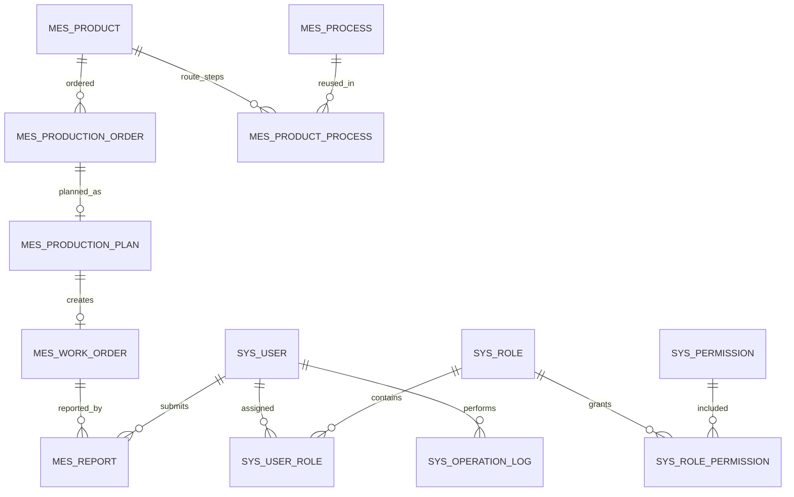

# 工擎 MES 数据库设计

| 项目 | 内容 |
| --- | --- |
| 项目名称 | 工擎 MES |
| 文档版本 | 1.0 |
| 文档状态 | 数据库方案，待评审确认 |
| 编写日期 | 2026-10-19 |
| 依据 | [需求规格说明书](requirements.md)、[系统架构设计](architecture.md) |
| 数据库 | MySQL 8.0，InnoDB，utf8mb4 |

## 1. 设计范围与原则

本文为工擎 MES 第一版设计关系型数据库，覆盖用户权限、产品、工序基础资料、生产订单、计划、工单、报工和操作审计。对应的初始化建表及基础权限数据脚本保存在 [docs/sql/init.sql](sql/init.sql)。该脚本尚未执行。

主要原则：

- 生产订单、计划、工单、报工关系以外键表达，不以客户端传入的关联名称或数量作为事实。
- 订单、计划、工单和报工是有生命周期的业务记录，不物理删除；取消、作废通过状态记录。
- 产品、工序等基础资料采用停用/逻辑删除；已被业务数据引用时不得删除。
- 数量均使用有符号 `BIGINT`，Java 对应 `Long`；使用 `CHECK` 限制数量范围。它支持大批量累计，也避免 MySQL `BIGINT UNSIGNED` 与 Java `Long` 范围不一致。
- 报工明细是产量事实来源。首版不在订单、计划和工单表保存可由报工汇总得到的重复累计数量。
- 状态使用可读的 `VARCHAR` 代码和 `CHECK` 约束，不使用 MySQL `ENUM`，以便将来增加状态。
- 订单/工单/报工等单据编号由应用生成，并由数据库唯一约束兜底。
- 时间戳列使用 `DATETIME(3)`，应用和数据库连接统一按 UTC 存取；报工业务日期使用 `DATE`，按企业业务时区解释。

## 2. 业务实体识别

| 实体 | 表 | 用途 |
| --- | --- | --- |
| 用户 | `sys_user` | 登录身份、显示名称、密码摘要和启停状态 |
| 角色 | `sys_role` | 管理员、生产经理、计划员、车间主管、操作员 |
| 权限 | `sys_permission` | 前端菜单及后端操作所使用的稳定权限编码 |
| 用户角色关系 | `sys_user_role` | 用户和角色多对多关联 |
| 角色权限关系 | `sys_role_permission` | 角色和权限多对多关联 |
| 产品 | `mes_product` | 被订单生产的单一产品资料 |
| 工序 | `mes_process` | 可复用的工序基础资料 |
| 产品工艺路线明细 | `mes_product_process` | 产品与工序的多对多、有序关系 |
| 生产订单 | `mes_production_order` | 单一产品的待生产需求 |
| 生产计划 | `mes_production_plan` | 将生产订单分解到车间执行 |
| 生产工单 | `mes_work_order` | 计划下的独立执行任务 |
| 生产报工 | `mes_report` | 关联工单、报工人、合格量和报废量的不可覆盖明细 |
| 操作审计 | `sys_operation_log` | 记录发布、确认、作废、权限变更等关键动作 |

## 3. 关系说明

关键基数：

- 一个产品可关联多个生产订单；一个订单只引用一个产品。
- 一个订单最多一份计划；通过 `mes_production_plan.production_order_id` 唯一索引保证。
- 一份已发布计划最多创建一张工单；工单必须且只属于一份计划。
- 一个工单可以有多条报工；报工必须引用存在的工单，并记录有效/作废状态。
- 产品与工序是多对多关系，通过 `mes_product_process.sequence_no` 表示该产品路线内工序顺序。
- 用户/角色、角色/权限均为多对多关系，由组合主键去重。

### 3.1 产品与工序的关系及首版范围

`mes_product` 与 `mes_process` 通过 `mes_product_process` 建立多对多、有序关系：一个产品可有多道工序，一道标准工序可被多个产品复用；同一产品路线中的 `sequence_no` 不重复。首版需求明确不做工艺路线流转、工序级工单或工序级报工，因此 `mes_production_order`、`mes_work_order`、`mes_report` 不关联 `mes_process`，工序表和路线明细只作为基础资料扩展点，不参与首版状态或数量计算。

若后续启用工序级执行，应增加带版本的路线及路线明细快照/工单工序表，使已发布工单引用确定版本；不能仅修改当前产品路线后让历史订单的工艺含义随之变化。当前设计不提前实现这些执行表和版本流程。

## 4. 表与字段设计

所有自增主键使用有符号 `BIGINT`，对应 Java `Long`。默认字符串排序规则为 `utf8mb4_0900_ai_ci`（MySQL 8）。业务编码唯一性按不区分大小写处理。外键删除规则为 `RESTRICT`，不使用级联删除。

### 4.1 用户权限表

#### `sys_user`

| 字段 | 类型 | 约束/说明 |
| --- | --- | --- |
| `id` | BIGINT | 主键，自增 |
| `username` | VARCHAR(64) | 必填、唯一，登录名 |
| `password_hash` | VARCHAR(100) | 必填，仅存 BCrypt 等密码哈希 |
| `display_name` | VARCHAR(80) | 必填 |
| `status` | VARCHAR(16) | `ACTIVE`、`DISABLED` |
| `last_login_at` | DATETIME(3) | 可空 |
| `created_at` | DATETIME(3) | 创建时间 |
| `updated_at` | DATETIME(3) | 更新时间 |

用户不物理删除，停用后保留其报工和审计引用。密码重置只更新哈希，不覆盖历史报工。

#### `sys_role`

字段：`id`、`role_code`（唯一）、`role_name`、`description`、`status`、`created_at`、`updated_at`。内置角色编码为 `ADMIN`、`PRODUCTION_MANAGER`、`PLANNER`、`WORKSHOP_SUPERVISOR`、`OPERATOR`。

#### `sys_permission`

字段：`id`、`permission_code`（唯一）、`permission_name`、`module_code`、`resource_type`（`MENU` 或 `ACTION`）、`status`、`created_at`。首版权限编码与架构文档约定一致，例如 `product:read`、`order:confirm`、`plan:publish`、`report:void`、`statistics:read`、`system:user:manage`。

#### `sys_user_role` 与 `sys_role_permission`

分别使用 `(user_id, role_id)`、`(role_id, permission_id)` 作为组合主键和唯一约束。外键限制关联删除，不增加没有独立业务含义的自增主键。

### 4.2 产品与工序表

#### `mes_product`

字段：`id`、`product_code`（唯一）、`product_name`、`specification`（可空）、`unit`、`status`（`ACTIVE`/`INACTIVE`）、`is_deleted`、`remark`（可空）、`created_by`、`created_at`、`updated_by`（可空）、`updated_at`。

产品被生产订单引用后禁止逻辑删除；已有订单仍可展示停用产品。新订单只能选择启用且未逻辑删除的产品。

#### `mes_process`

字段：`id`、`process_code`（唯一）、`process_name`、`description`（可空）、`status`（`ACTIVE`/`INACTIVE`）、`is_deleted`、`created_at`、`updated_at`。

#### `mes_product_process`

字段：`id`、`product_id`、`process_id`、`sequence_no`、`created_at`、`created_by`。`UNIQUE(product_id, sequence_no)` 保证同一产品路线步骤顺序唯一；另为 `process_id` 建立索引。当前为产品的可编辑路线配置，不代表已发布生产订单的路线快照。

### 4.3 生产业务表

#### `mes_production_order`

字段：

| 字段 | 类型 | 约束/说明 |
| --- | --- | --- |
| `id` | BIGINT | 主键，自增 |
| `order_no` | VARCHAR(40) | 必填、唯一 |
| `product_id` | BIGINT | 必填，外键到产品 |
| `order_qty` | BIGINT | 必填且大于 0，订单数量 |
| `due_date` | DATE | 可空，要求完成日期 |
| `status` | VARCHAR(20) | `DRAFT`、`CONFIRMED`、`IN_PROGRESS`、`COMPLETED`、`CANCELLED` |
| `remark` | VARCHAR(500) | 可空 |
| `created_by` | BIGINT | 必填，创建用户 |
| `created_at` | DATETIME(3) | 创建时间 |
| `updated_by` | BIGINT | 可空 |
| `updated_at` | DATETIME(3) | 更新时间 |

不保存产品名称、计划数量、已完成量或进度的副本。产品名通过 `product_id` 查询；订单计划量来自唯一计划；完成量由有效报工聚合。

#### `mes_production_plan`

字段：`id`、`plan_no`（唯一）、`production_order_id`（唯一外键）、`plan_qty`（大于 0）、`start_date`、`end_date`、`priority`（非负整数，默认 0）、`status`（`DRAFT`、`RELEASED`、`IN_PROGRESS`、`COMPLETED`、`CANCELLED`）、`remark`、`created_by`、`created_at`、`updated_by`、`updated_at`、`released_by`、`released_at`。

唯一 `production_order_id` 保证一个订单最多一份计划。计划量必须等于订单量，依赖后端服务事务校验；关系型 `CHECK` 不能直接跨表验证。

#### `mes_work_order`

字段：`id`、`work_order_no`（唯一）、`plan_id`（必填外键）、`sequence_no`、`planned_qty`（大于 0）、`start_date`、`end_date`、`status`（`PENDING`、`RELEASED`、`IN_PROGRESS`、`PAUSED`、`COMPLETED`、`CANCELLED`）、`remark`、`created_by`、`created_at`、`updated_by`、`updated_at`。

`UNIQUE(plan_id)` 保证一个计划最多创建一张工单。`sequence_no` 保留为正整数扩展字段，首版固定为 1。工单不重复保存订单 ID、产品 ID、产品名或累计产量：这些信息可经计划/订单关联查询，避免产品关联与计划产品不一致；工单计划量必须等于计划量，由服务端从计划读取。

计划发布只将草稿计划变更为 `RELEASED`。随后工单模块从有效的已发布计划创建一张工单，数量与日期从计划读取；一个计划最多一张工单由唯一索引和事务内锁定检查共同保证。

#### `mes_report`

字段：

| 字段 | 类型 | 约束/说明 |
| --- | --- | --- |
| `id` | BIGINT | 主键，自增 |
| `report_no` | VARCHAR(40) | 必填、唯一 |
| `request_key` | CHAR(36) | 必填、唯一；客户端为一次报工生成 UUID，重试沿用 |
| `work_order_id` | BIGINT | 必填，外键到工单 |
| `reporter_id` | BIGINT | 必填，服务端当前用户 |
| `report_date` | DATE | 必填，生产业务日期 |
| `good_qty` | BIGINT | 必填，非负合格数量 |
| `scrap_qty` | BIGINT | 必填，非负报废数量 |
| `report_status` | VARCHAR(10) | `VALID` 或 `VOID` |
| `remark` | VARCHAR(500) | 可空 |
| `created_at` | DATETIME(3) | 创建时间 |
| `voided_by` | BIGINT | 可空，作废用户 |
| `voided_at` | DATETIME(3) | 可空，作废时间 |
| `void_reason` | VARCHAR(500) | 可空，作废原因 |

约束：`good_qty >= 0`、`scrap_qty >= 0`、两者不能同时为 0；状态为 `VOID` 时作废人、时间、原因必填，状态为 `VALID` 时三者为空。报工没有普通更新/删除流程；作废只补充作废字段，保留原数量、报工人和原记录。

**数量口径**：有效完成数为 `SUM(good_qty + scrap_qty)`；合格产量和报废量分别统计；完成率以合格量加报废量除以计划量计算，最高为 100%。所有汇总必须过滤 `report_status = 'VALID'`。

### 4.4 操作审计表

#### `sys_operation_log`

字段：`id`、`user_id`（可空，允许记录未认证请求结果）、`operation_code`、`target_type`、`target_id`（可空）、`result`（`SUCCESS`/`FAILURE`）、`detail`（可空、禁止存凭据/密码）、`created_at`。日志为追加记录，不更新或删除。按用户/时间、目标类型/ID、操作代码/时间建立索引。

## 5. 状态字段

| 表 | 状态代码 | 主要转换规则 |
| --- | --- | --- |
| `sys_user` | `ACTIVE`、`DISABLED` | 停用阻止登录，不影响历史记录 |
| `sys_role`、`sys_permission` | `ACTIVE`、`DISABLED` | 停用不删除授权历史关系 |
| `mes_product`、`mes_process` | `ACTIVE`、`INACTIVE` | 停用阻止新订单/新路线配置引用 |
| `mes_production_order` | `DRAFT`、`CONFIRMED`、`IN_PROGRESS`、`COMPLETED`、`CANCELLED` | 关联工单开工后进入生产中；工单完成后同步完成 |
| `mes_production_plan` | `DRAFT`、`RELEASED`、`IN_PROGRESS`、`COMPLETED`、`CANCELLED` | 发布后可创建一张工单；工单开工后进入生产中 |
| `mes_work_order` | `PENDING`、`RELEASED`、`IN_PROGRESS`、`PAUSED`、`COMPLETED`、`CANCELLED` | 下发后可开工；暂停可恢复；有效完成量等于计划量后才可完成 |
| `mes_report` | `VALID`、`VOID` | 仅可由有权限用户作废，需记录原因；作废后不计进度 |

状态值仅说明当前状态，状态变更人和时间由业务表中的创建/发布/作废字段及 `sys_operation_log` 追溯。首版不额外增加每个单据的全量状态历史表。

## 6. 主键、唯一约束和索引

### 6.1 唯一约束

- `sys_user.username`
- `sys_role.role_code`
- `sys_permission.permission_code`
- `sys_user_role(user_id, role_id)`、`sys_role_permission(role_id, permission_id)`
- `mes_product.product_code`、`mes_process.process_code`
- `mes_product_process(product_id, sequence_no)`
- `mes_production_order.order_no`
- `mes_production_plan.plan_no`、`mes_production_plan.production_order_id`
- `mes_work_order.work_order_no`、`mes_work_order.plan_id`
- `mes_report.report_no`

订单号和工单号都由唯一索引保护。应用生成编号冲突时必须捕获重复键错误并重试/返回冲突，不可依赖“先查询是否存在”来保证唯一性。

### 6.2 查询索引

- 订单：`(status, due_date)`、`(product_id, created_at)`。
- 计划：`(status, start_date, end_date)`；订单 ID 已由唯一索引覆盖。
- 工单：`(plan_id, status)`、`(status, start_date, end_date)`；供计划详情和车间待办查询。
- 报工：`(work_order_id, report_status, report_date)`、`(reporter_id, report_date)`，支持进度、日报和本人报工查询。
- 产品/工序路线：产品状态索引、`(process_id)`；路线主查询使用产品 ID 唯一组合索引。
- 审计日志：`(user_id, created_at)`、`(target_type, target_id, created_at)`、`(operation_code, created_at)`。
- 关系表外键字段均有索引，必要时由唯一复合索引覆盖；MySQL 外键本身也要求可用索引。

索引应依据实际 `EXPLAIN` 结果迭代；不要为每个字段单独建立索引，避免写入成本和冗余索引。

## 7. 逻辑删除与数据追溯

- 产品和工序使用 `is_deleted` 与业务启停状态区分：“停用”保留可见历史，“逻辑删除”用于隐藏未被引用的错误基础资料。被订单或路线引用时必须拒绝逻辑删除。
- 用户、角色、权限通过 `status` 停用，不物理删除，保证报工和授权记录可解释。
- 订单、计划、工单不提供删除标记；已创建数据以取消状态终止，并保留创建/更新/发布者。
- 报工不逻辑删除、不覆盖数量；用 `VALID/VOID` 和作废人、时间、原因保留修正轨迹。
- 操作日志只追加。限制记录内容，避免写入密码、会话、CSRF Token 或完整敏感请求体。
- 全部外键使用 `ON DELETE RESTRICT`，应用对引用中的业务实体执行停用/取消，不物理级联删除。

## 8. 初始数据设计

SQL 初始化脚本会插入五个固定角色及首版权限、角色权限映射，不插入拥有默认弱密码的管理员账号。

| 角色编码 | 初始授权概要 |
| --- | --- |
| `ADMIN` | 全部权限；包含报工作废和用户角色管理 |
| `PRODUCTION_MANAGER` | 看板、产品管理、订单管理、计划/工单/报工/统计查看 |
| `PLANNER` | 看板、产品查看、订单查看、计划及工单管理、报工和统计查看 |
| `WORKSHOP_SUPERVISOR` | 看板、产品/订单/计划/工单/报工/统计查看 |
| `OPERATOR` | 可执行工单查看、本人报工查询、报工创建 |

初始管理员账号由部署/首次启动流程通过环境变量提供用户名和随机密码摘要，或在初始化后通过受控的一次性管理命令创建。不得把明文密码或通用默认密码写入 SQL、Git 或镜像。

产品、工序和生产业务单据不预置演示记录；可单独准备仅供开发环境使用的演示数据脚本。

## 9. 数据冗余审查

首版表结构刻意不冗余以下字段：

- 订单不复制产品编码/名称；通过 `product_id` 读取产品当前资料。若将来要求历史订单显示创建时名称快照，再按业务规则增加快照字段。
- 计划不复制产品 ID，因为由唯一订单可得产品。
- 工单不重复存订单 ID、产品 ID 或产品名称，因为均可由计划到订单关联查询。
- 订单、计划、工单不存可从 `mes_report` 得出的合格量、报废量、完成量和进度，避免累计字段与报工明细不一致。
- 不添加无明确查询或审计用途的 `version`、`deleted_by`、`extra_json`、备注快照等字段。

代价是列表和统计查询需要适当 JOIN/聚合。按需求的数据量，先用正确关系和必要索引；性能数据证明有瓶颈后再受控增加汇总字段，并提供事务同步及重算校验。

## 10. 一致性保障

数据库约束与后端事务共同保证正确性，前端校验只用于即时反馈。

1. **主键与关联**：外键确保计划指向订单、工单指向计划、报工指向工单；删除受引用记录由数据库拒绝。
2. **编号唯一**：数据库唯一索引是订单号、工单号及其他单据编号唯一性的最终保障。
3. **数量类型/范围**：数量用 `BIGINT` 整数，`CHECK` 校验非负/正数；报工需至少有合格量或报废量。
4. **订单/计划/工单数量关系**：创建计划时在服务端事务中检查计划量等于订单量；从计划创建工单时锁定关联订单和计划，并从计划读取工单数量，`UNIQUE(mes_work_order.plan_id)` 防止同一计划重复建单。
5. **并发报工不超量**：在单个数据库事务中对工单行 `SELECT ... FOR UPDATE`，随后聚合有效报工、检查剩余量、插入明细、更新工单/计划/订单状态。相同工单的报工串行化；不同工单可并行。
6. **防止跨表不一致**：状态流转由 Service 层按明确定义执行。所有关联更新成功后才提交；任一步失败整笔回滚。
7. **作废一致性**：事务中锁定报工及工单，验证权限/原因，标记作废后重算有效数量及工单、计划、订单状态；进度和统计查询仅汇总 `VALID` 记录。
8. **防止重复请求**：每次报工命令携带唯一 `request_key`，数据库唯一索引阻止同一命令因网络重试而重复落库；前端对同一次提交重试必须复用该键。不同键代表不同报工，仍受工单行锁和剩余量校验约束。
9. **跨表规则边界**：MySQL `CHECK` 不支持引用其他表或聚合其他行，故产品启用状态、计划-订单量相等、计划工单总量和报工剩余量必须由事务服务验证；关键单表范围再由数据库约束兜底。

## 11. SQL 脚本使用说明

- 完整 DDL 与固定 RBAC 初始数据位于 `docs/sql/init.sql`。
- 该文件是待评审的初始建库脚本；本阶段只生成文件，不执行 SQL，不连接数据库。
- 脚本面向 MySQL 8.0.16+，该版本开始强制执行 `CHECK` 约束；字符集为 `utf8mb4`，引擎为 InnoDB。
- 架构方案建议生产使用 Flyway 版本化迁移。确认本设计后，可将 DDL 拆为 `V1__init_schema.sql` 等迁移文件；不要在已经由 Flyway 管理的库上重复执行完整 init 脚本。
- `CREATE DATABASE` / `USE` 仅适用于本地手动初始化；生产 Flyway 应由连接 URL 选择已创建数据库，并只运行迁移 DDL。

## 12. 质量与设备管理扩展

V6 迁移新增 `mes_quality_inspection`、`mes_equipment` 和 `mes_equipment_maintenance`。质检记录关联工单并可选关联报工，记录不可覆盖修改；后端锁定工单核验工单级累计检验量不超过有效报工合格量，关联报工时还要检查报工级上限。设备维修履历追加保存开始/结束操作人和时间，并在同一事务同步设备维修状态。设备状态是人工维护档案字段，不代表采集数据。权限和字段详情见 `docs/quality-equipment-design.md`。

## 13. 待确认的关键设计决策

1. **产品—工序路线范围**：接受本方案的产品与工序多对多有序关联，但首版工单/报工暂不引用工序吗？这遵守现有需求文档的 MVP 边界。若要首版工序级执行，需要先补充工序任务、工序报工、工序状态与数量规则，并增加路线版本/工单工序快照。
2. **订单/工单产品冗余**：接受工单仅引用计划、订单通过计划关联，避免重复保存产品和订单 ID 吗？代价是查询需要 JOIN。
3. **进度存储**：接受首版不存订单/计划/工单的累计合格量、报废量和进度，按有效报工查询汇总吗？这样可以避免冗余计数不一致。
4. **操作审计**：接受以业务表中的状态/作废字段加一张通用追加式操作日志表追溯首版关键动作吗？不建全量单据状态快照表。

