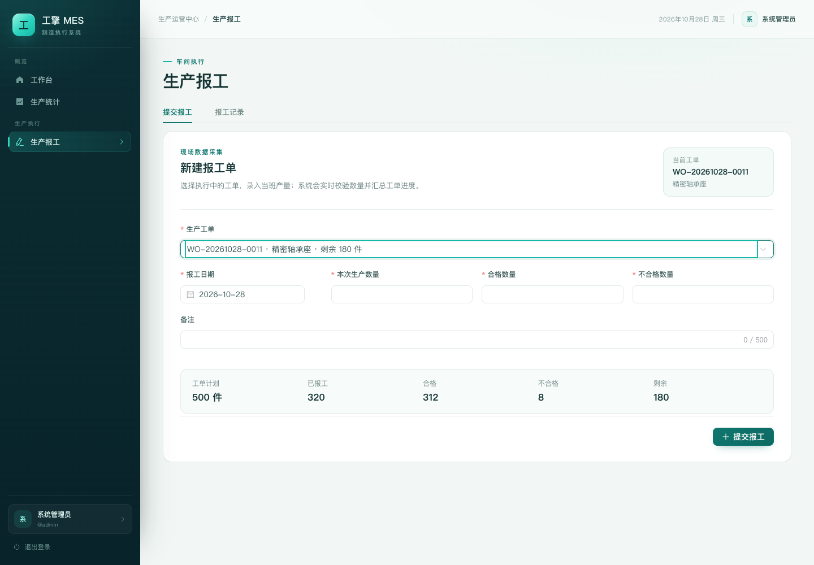

# 前端视觉升级说明

本次升级只调整前端信息架构、设计系统和响应式表现，不改动后端接口、数据库、权限规则或生产业务逻辑。

## 1. 设计目标

- 从“通用后台表格”升级为有制造现场气质的工业 SaaS 界面。
- 用固定侧栏承载 11 个业务入口，降低顶部导航在 1440px 以下的拥挤感。
- 统一颜色、圆角、阴影、表格、表单和弹窗，减少各页面自行硬编码造成的割裂。
- 保留桌面端的数据密度，同时让移动端可完成查看、筛选和报工等核心操作。

## 2. 信息架构

`frontend/src/components/AppHeader.vue` 现在由三部分组成：

| 区域 | 说明 |
| --- | --- |
| 深青侧栏 | 品牌、权限过滤后的分组菜单、当前用户与退出登录 |
| 顶部栏 | 面包屑、当前日期、用户头像；移动端显示菜单按钮 |
| 内容区 | 各业务页面，使用统一的 `app-main` 容器 |

菜单按业务域分组：

- 概览：工作台、生产统计
- 主数据：产品管理、工序管理
- 生产执行：生产订单、生产计划、生产工单、生产报工
- 质量与设备：质量管理、设备管理
- 系统：系统管理

`<= 1024px` 时侧栏变为抽屉，点击遮罩或菜单项后自动关闭；`<= 680px` 时隐藏日期和用户名，仅保留头像与菜单入口。

## 3. 设计系统

核心变量位于 `frontend/src/styles/main.css`：

```css
--brand: #0f766e;
--brand-deep: #0b5e58;
--brand-bright: #14b8a6;
--ink: #143534;
--muted: #6f8785;
--bg: #f2f7f5;
--line: #e1ebe8;
--radius-lg: 16px;
--sidebar-width: 248px;
--topbar-height: 68px;
```

统一覆盖的 Element Plus 组件包括按钮、输入框、下拉、日期选择、表格、分页、标签、页签、弹窗、描述列表和空状态。页面不再各自定义主色，新增页面应优先使用上述变量。

## 4. 重点页面

### 登录页

左侧采用深青工业视觉和 CNC 加工场景图片，右侧为独立登录卡片。背景图经过压缩后放在 `frontend/src/assets/login-visual.jpg`，由 CSS 渐变覆盖以保证文字对比度。


### 工作台

工作台由“欢迎 Hero + 生产概况 + 快捷入口”组成：

- Hero 区展示问候语、当前日期、角色和系统连接状态。
- 四个指标卡分别展示生产订单、生产中工单、有效报工产量、质检不合格。
- 产品筛选和“查看详细报表”放在指标区上方，保持操作路径短。
- 快捷入口按当前用户权限生成，不再展示无权访问的模块。


### 生产统计与报表

- 筛选区独立为工具栏，日期、产品、订单状态和查询按钮在一行内完成。
- 五张指标卡使用不同的顶部强调色，指标口径副标题保持可见。
- 趋势图、工单状态环图、计划执行柱状图统一为白色圆角卡片。
- 工单状态环图在移动端隐藏外置标签，改为底部图例，避免标签被裁切。
- 产品排行改为全宽表格，报工明细保留横向滚动，避免窄屏下列被截断。


### 生产报工

提交报工区从“裸表单”改为完整卡片：

- 标题区说明录入场景，并在选择工单后显示当前工单与产品。
- 表单、工单累计数据、数量核对和提交按钮在同一视觉容器内。
- 工单计划、已报工、合格、不合格、剩余五项汇总使用独立数据条。



## 5. 响应式

- `1200px`：内容区与图表网格开始收紧。
- `1024px`：侧栏切换为抽屉。
- `900px`：统计卡片从 5 列降为 3 列，快捷入口降为 2 列。
- `700px`：指标卡 2 列，图表单列，表格允许横向滑动。
- `480px`：表单单列，登录页改为上下布局，快捷入口单列。

移动端首页：


## 6. 验证

```bash
cd frontend
npm run build
```

最近一次构建结果：2267 个模块转换成功；CSS 约 396 KB（gzip 55 KB），JS 约 2.27 MB（gzip 738 KB），仅有 Vite 的 chunk 体积提示。

使用 Playwright + 系统 Chrome 对登录、工作台、产品、统计、订单、计划、工单、报工、质量、设备、系统页面做了视觉回归；桌面端和 390px 移动端均无页面异常、无横向页面溢出。截图中的业务数据来自本地接口 mock，仅用于视觉验收，不代表生产数据。

## 7. 相关文件

- `frontend/src/components/AppHeader.vue`
- `frontend/src/styles/main.css`
- `frontend/src/views/LoginView.vue`
- `frontend/src/views/HomeView.vue`
- `frontend/src/views/StatisticsView.vue`
- `frontend/src/views/ReportsView.vue`
- `frontend/src/assets/login-visual.jpg`
- `docs/screenshots/`
