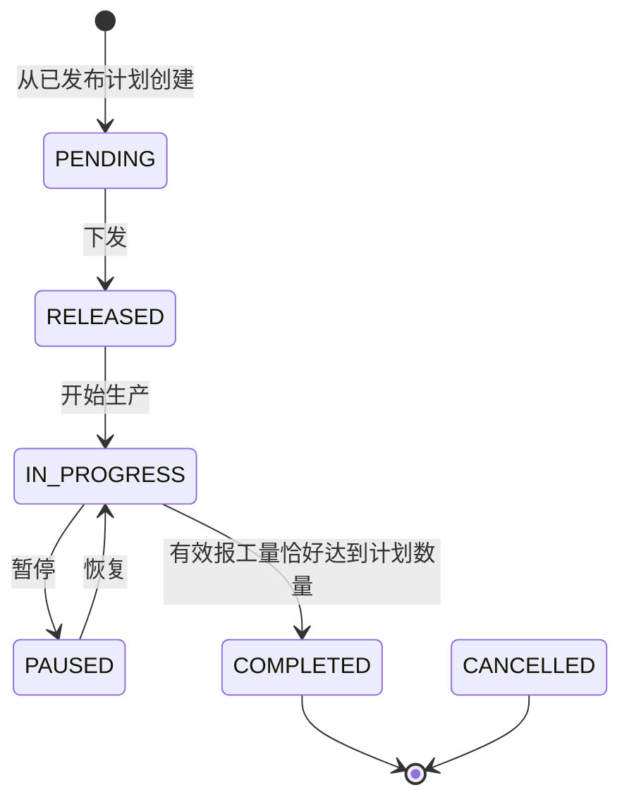

# 生产工单模块设计与实现

## 状态流转

`COMPLETED`、`CANCELLED` 为终态。首版工单模块不提供手动取消入口；计划取消流程只会取消仍处于 `PENDING` 的工单。

## 接口清单

所有接口使用统一响应体，并要求登录。读取接口需要 `workorder:read` 或 `workorder:manage`；创建与状态操作要求 `workorder:manage`。报工记录读取还允许 `report:read`。

| 方法 | 路径 | 用途 |
| --- | --- | --- |
| `GET` | `/api/v1/work-orders/available-plans` | 查询已发布、订单有效且尚无工单的计划 |
| `GET` | `/api/v1/work-orders` | 分页筛选工单：工单号、产品、状态、计划开始日期区间 |
| `POST` | `/api/v1/work-orders/from-plan/{planId}` | 从生产计划创建工单，仅接收备注 |
| `GET` | `/api/v1/work-orders/{id}` | 查询工单详情及报工汇总 |
| `GET` | `/api/v1/work-orders/{id}/reports` | 分页查询关联的全部报工记录，包括已作废记录 |
| `PATCH` | `/api/v1/work-orders/{id}/dispatch` | 下发工单 |
| `PATCH` | `/api/v1/work-orders/{id}/start` | 开始生产 |
| `PATCH` | `/api/v1/work-orders/{id}/pause` | 暂停生产 |
| `PATCH` | `/api/v1/work-orders/{id}/resume` | 恢复生产 |
| `PATCH` | `/api/v1/work-orders/{id}/complete` | 完成工单 |

所有状态操作请求体都需包含工单查询返回的 `expectedUpdatedAt`，服务端使用行锁和状态/时间条件更新拦截重复请求与过期页面提交。

## 业务规则

1. 工单只能由已发布计划创建，关联订单必须仍为 `CONFIRMED`。一个计划只能创建一张工单，工单数量和日期从计划读取，数量必须等于订单数量，不接受客户端提供数量或状态。
2. 工单编号由服务端生成，并由 `uk_mes_work_order_no` 唯一索引兜底；同计划重复创建还受计划/序号唯一约束与事务内检查保护。
3. 每次状态修改验证允许的源状态。开始生产时，计划和订单必须仍有效；订单、计划和工单按固定顺序加锁，并在同一事务更新计划/订单状态。
4. 暂停和恢复只改变工单状态，关联计划与订单保持 `IN_PROGRESS`。
5. 完成时有效报工量口径为 `SUM(good_qty + scrap_qty)` 且仅统计 `report_status='VALID'`，必须恰好等于工单计划量。数量不足或超额均不能完成；同一事务将计划和订单置为完成。
6. 状态变更及创建写入 `sys_operation_log`。事务失败时业务数据和审计记录一并回滚。
7. 工单列表的日期筛选采用计划开始日期 (`start_date`)；详情可查看全部关联报工记录，进度仅计有效报工。
8. 取消工单为数据库保留的终态，首版没有独立取消 API。计划取消只能在不存在已开始工单及有效报工时进行，并由计划模块取消待下发工单。

## 实现文件

- 后端：`modules/workorder/WorkOrderController`、`WorkOrderService`、`WorkOrderMapper`、`WorkOrderAuditMapper`。
- 前端：`api/workOrders.js`、`views/WorkOrdersView.vue` 和 `/work-orders` 路由。
- 数据库：工单状态约束通过 `docs/sql/V4__work_order_lifecycle.sql` 扩展为包含 `RELEASED`、`PAUSED`；新建数据库的 `init.sql` 已包含完整状态集合。

## 验证

工单服务单元测试覆盖从计划创建、数量/状态限制、完整合法状态链、非法状态跳转、终态恢复、并发版本冲突和报工数量不匹配。执行 `cd backend && mvn test` 与 `cd frontend && npm run build` 验证。
